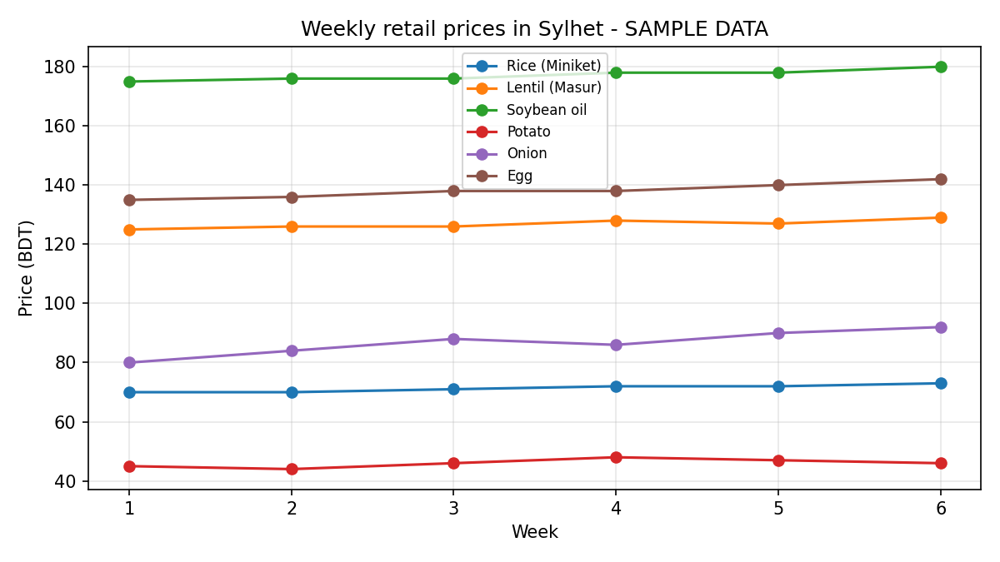

# Sylhet Market Price Tracker

A small primary-data project tracking weekly retail prices of six staple food items in a Sylhet market.

> **Note:** The values in this repository are **SAMPLE DATA** used to demonstrate the template. Replace them with real collected prices before treating any finding as real.

## Objective
To observe how the prices of everyday essentials change over several weeks and which items rise fastest.

## Items tracked
Rice (Miniket), Lentil (Masur), Soybean oil, Potato, Onion, Egg.

## Data and method
- Prices were recorded once a week from the same shop, at the same time of day.
- Data is stored in `data/sylhet_market_prices.xlsx` (sheet **Prices**).
- The **Summary** sheet calculates week-1 vs latest price, change in BDT, change in %, average, maximum and minimum using Excel formulas.

## Key findings
*(Fill in after replacing the sample data with real prices.)*
- Finding 1: which item changed the most, and by how much.
- Finding 2: which item stayed stable.
- Finding 3: a possible reason (season, supply, festival, import price).



## Limitations
- Prices come from one market, so they may not represent all of Sylhet.
- The observation period is short, so seasonal patterns cannot be confirmed.
- Retail price depends on shop, quality and quantity.

## Possible next steps
- Add more weeks and more markets.
- Compare with official BBS price data.
- Calculate a simple price index for the basket.

## Repository structure
```
sylhet-market-price-tracker/
├── README.md
├── data/
│   └── sylhet_market_prices.xlsx
└── charts/
    └── price_trend.png
```

## Author
Adnan, Economics, Shahjalal University of Science and Technology (SUST)
